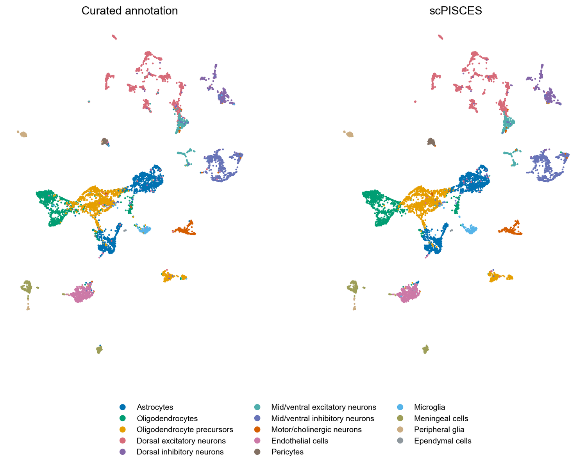
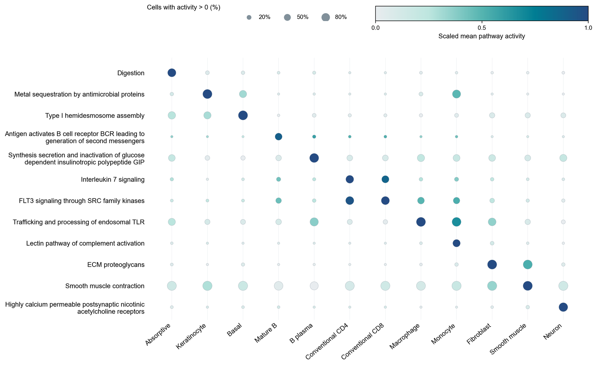
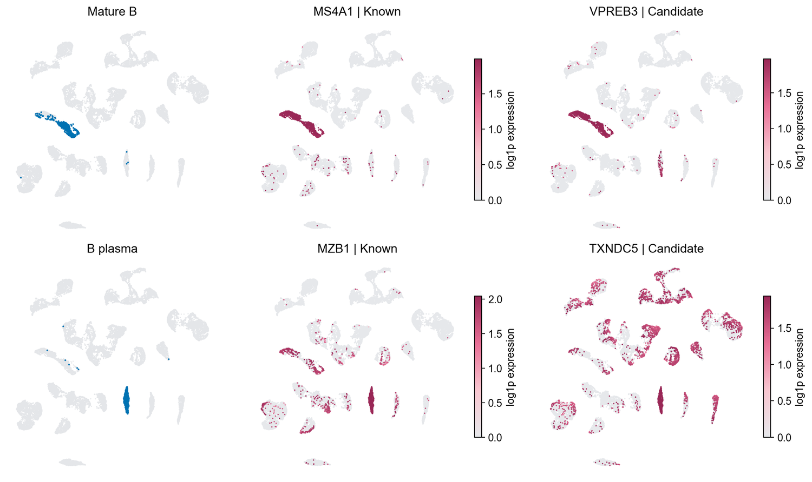
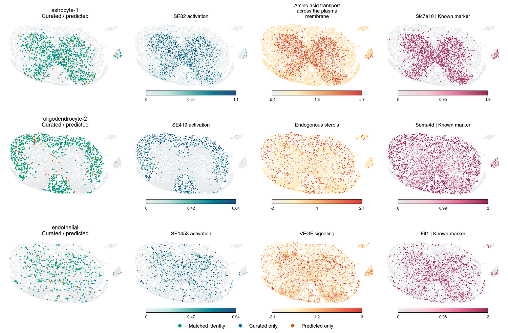
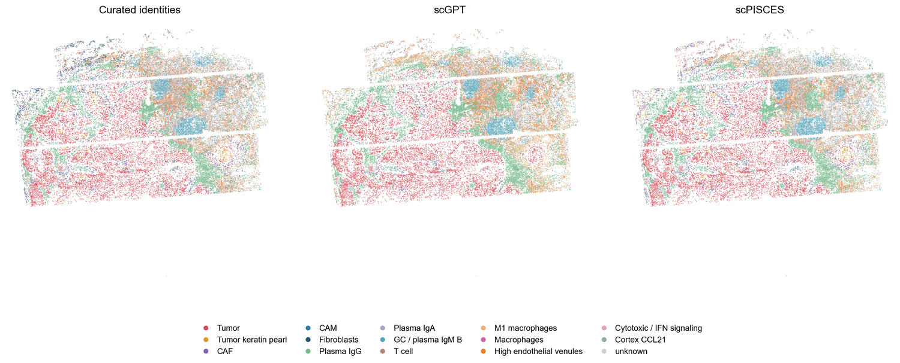

# Tutorials

Open a notebook on GitHub to see the saved figures and tables. Each example
includes the small data extracts needed to rerun its analysis on a CPU.

| Notebook | Example |
| --- | --- |
| [Cell annotation](Tutorial_Annotation_MERFISH.ipynb) | MERFISH predictions, model-embedding UMAPs and spatial subtype maps |
| [Pathway programs](Tutorial_Pathway_Programs.ipynb) | Pan-GI guided programs and their aligned Reactome activities |
| [Marker prioritization](Tutorial_Marker_Genes.ipynb) | Program-gene networks, expression UMAPs and marker dot plots |
| [Spatial programs](Tutorial_Spatial_Programs_MERFISH.ipynb) | Cell identity, sparse programs, pathways and genes in tissue; spatial neighborhood networks |
| [Tumor microenvironment](Tutorial_Tumor_Microenvironment_OpenST.ipynb) | Open-ST tissue maps, tumor/stromal compartments and cell-label correspondence |

## Preview

| MERFISH annotation | Pan-GI pathway atlas |
| --- | --- |
| [](Tutorial_Annotation_MERFISH.ipynb) | [](Tutorial_Pathway_Programs.ipynb) |
| **Marker and candidate genes** | **Spatial program localization** |
| [](Tutorial_Marker_Genes.ipynb) | [](Tutorial_Spatial_Programs_MERFISH.ipynb) |

### Open-ST tumor microenvironment

[](Tutorial_Tumor_Microenvironment_OpenST.ipynb)

## Run locally

From the repository root:

```bash
python -m pip install -r tutorials/requirements.txt
jupyter lab tutorials/
```

Or rerun an example without opening Jupyter:

```bash
python scripts/run_tutorials.py --list
python scripts/run_tutorials.py --notebook openst --html
python scripts/run_tutorials.py --all --html
```

Executed copies and optional HTML pages go to `outputs/executed/`; tracked
notebooks are unchanged. The runner verifies bundled checksums and checks that
each example produces its expected figures. A lightweight GitHub Actions job
runs the same command on a CPU. See the [quick start](../docs/quickstart.md).

Run each notebook from top to bottom. Figures are also exported to
`tutorials/outputs/` as PNG and SVG with editable text. Arial is used when
installed; otherwise a local sans-serif fallback is used.

The annotation notebook includes an optional command for applying a fine-tuned
scPISCES checkpoint to a new query. That step additionally requires the main
package, a compatible checkpoint, its gene vocabulary and an expression file.
These model assets are not part of the small example bundle.

## Example data

The files in [data/](data/) are compact extracts from the study's archived
numerical results, rather than simulated observations. MERFISH examples use
6,602 query cells; Pan-GI cell-level examples use 31,000 cells; Open-ST uses
39,167 cells from one metastatic lymph-node section. Population-level
program summaries use curated annotations. Details and source identifiers are
listed in [data/README.md](data/README.md).

The tutorials are organized by task, following the approachable example style of
[scGPT](https://github.com/bowang-lab/scGPT/tree/main/tutorials) and
[scFoundation](https://github.com/biomap-research/scFoundation). All scPISCES
figures and example tables here come from this study's archived analyses.
